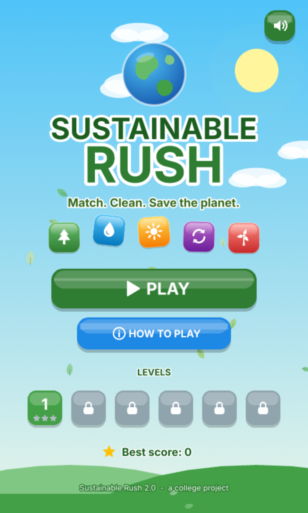
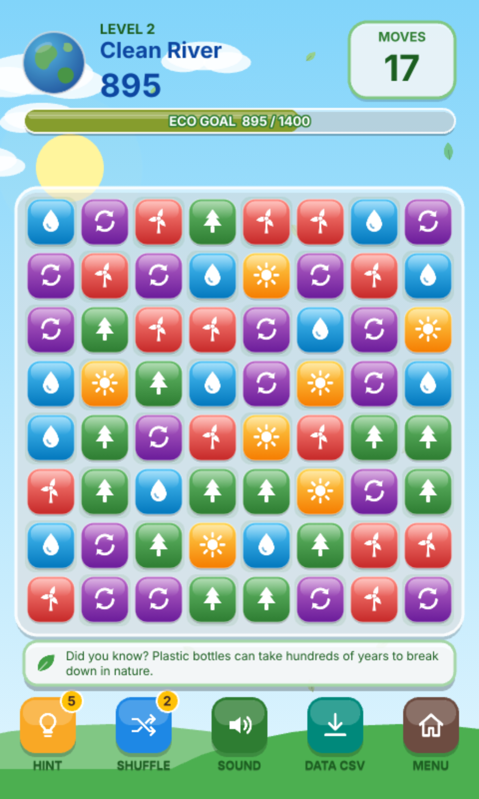
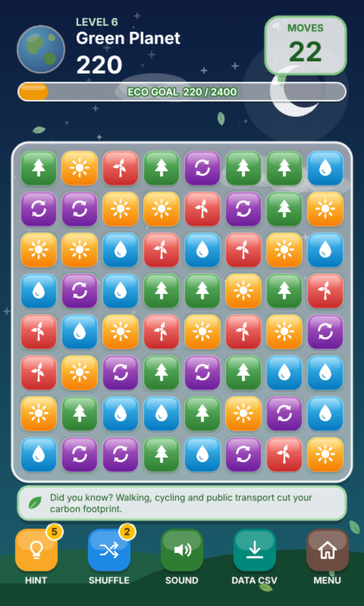
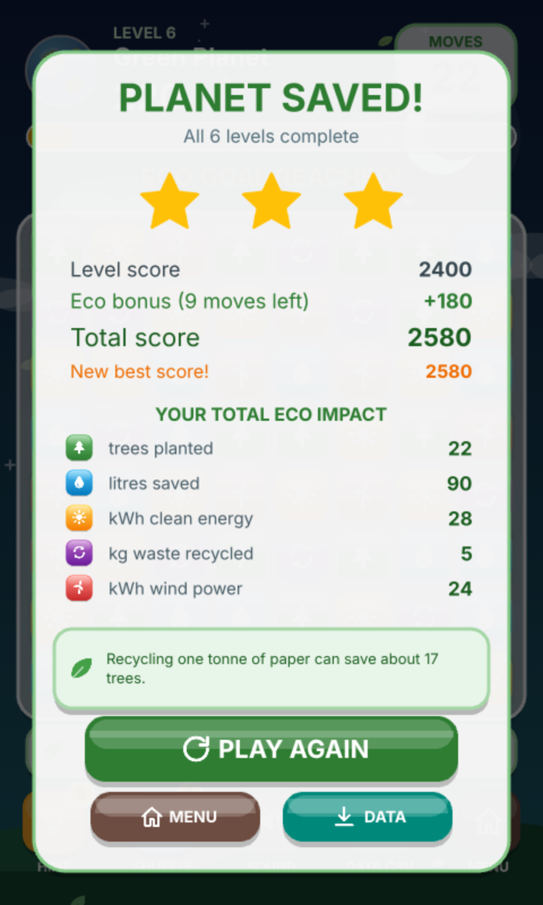

# 🌱 Sustainable Rush 2.0

🎮 **Play online:** https://Rushabh-28.github.io/sustainable-rush/

An eco-friendly **match-3 puzzle game** that runs in any web browser. Swap tiles, match
**trees, water, solar, recycling and wind** symbols, and clean up the planet one level at a time.

> College project · Built with HTML5, CSS3, JavaScript and the [Phaser 3](https://phaser.io) game engine.

<p align="center">
  
  
  
</p>
<p align="center">
  
</p>

## ✨ Features

| | |
|---|---|
| 🎮 **6 themed levels** | Seedling Park → Clean River → Solar Valley → Windy Coast → Recycle City → Green Planet. Every level has its own sky (dawn → day → sunset → night), goal and move limit. |
| 🌍 **Living planet meter** | The Earth in the top-left starts covered in smog and gets cleaner as your eco-score grows. |
| ⚡ **Dynamic gameplay** | Cascading combos with score multipliers, bonus points for 4+ matches, leftover-move bonus, 1–3 star ratings, screen shake, particles, falling leaves and drifting clouds. |
| 🤖 **AI hint system** | Searches every possible swap and suggests the one that clears the most tiles. Also nudges you automatically if you idle for 8 s. |
| 🔀 **Auto-shuffle** | If the board ever has no valid move, it re-deals itself (and you also get 2 manual shuffles per level). |
| 📱 **Works everywhere** | Tap or **swipe** to play. The canvas scales to any phone, tablet or desktop screen. Keyboard: `H` hint · `S` shuffle · `M` mute. |
| 📊 **Eco impact report** | Every cleared tile counts toward trees planted, litres of water saved, kWh of clean energy and kg recycled. A random eco-fact is shown after each level. |
| 💾 **Progress saving** | Best score, unlocked levels and star ratings are stored in the browser (`localStorage`). |
| 📄 **Player-data export** | One click exports every move (position, match or not, tiles cleared, chain length, thinking time, hint used…) to a **CSV file** for data-analysis. |
| 🔊 **Synthesised sound** | All sound effects are generated with the Web Audio API, so there are no audio files to download. |
| 🎨 **Zero image files** | All icons are SVG code. The whole game is only a few HTML/CSS/JS files. |

## 🕹️ How to play

1. **Tap** two neighbouring tiles (or **swipe** a tile) to swap them.
2. Line up **3 or more** identical eco tiles in a row or column to clear them.
3. Reach the **Eco Goal** before you run out of moves.
4. Chain reactions multiply your points. Use leftover moves for a bonus.

A swap that doesn't create a match bounces back and costs **no move**.

| Tile | Meaning | Each cleared tile adds |
|---|---|---|
| 🌲 Tree | Reforestation | 1 tree planted |
| 💧 Water | Water conservation | 5 litres saved |
| ☀️ Solar | Solar power | 2 kWh clean energy |
| ♻️ Recycle | Waste recycling | 0.5 kg recycled |
| 🌬️ Wind | Wind power | 3 kWh wind power |

*(These impact values are game numbers chosen for fun and learning, not scientific measurements.)*

## 🚀 Run it on your computer

The game is a static website, so there is **nothing to install**.

**Option A: simplest.** Double-click `index.html`.

**Option B: local web server** (recommended, behaves exactly like the live site):

```bash
# Python 3
python -m http.server 8000
# then open http://localhost:8000
```

or use the **Live Server** extension in VS Code (right-click `index.html` → *Open with Live Server*).

## 🌐 Play online (GitHub Pages)

See **[docs/GITHUB_GUIDE.md](docs/GITHUB_GUIDE.md)** for the complete step-by-step guide to uploading
the project to GitHub and publishing it as a free website.

## 🗂️ Project structure

```
sustainable-rush/
├── index.html            # page + script loading order
├── css/style.css         # page layout (full-screen, centred canvas)
├── js/
│   ├── config.js         # ★ levels, goals, tile types, scoring, eco facts (edit to rebalance)
│   ├── icons.js          # SVG icons + tile artwork, turned into textures at start-up
│   ├── audio.js          # Web Audio sound effects
│   ├── storage.js        # localStorage save + move logger / CSV export
│   ├── ui.js             # buttons, panels, animated backdrop, particles
│   ├── main.js           # Phaser game setup
│   └── scenes/
│       ├── BootScene.js      # builds textures
│       ├── MenuScene.js      # title, level select, how-to-play
│       ├── GameScene.js      # the match-3 engine
│       └── ResultScene.js    # level-complete / game-over / planet-saved
├── lib/phaser.min.js     # Phaser 3.90 (bundled so the game works offline)
├── assets/favicon.svg
└── docs/                 # guides + screenshots
```

## 🧠 How the game engine works

```
swap two tiles
   └─ no match?  → swap back, no move spent
   └─ match?     → spend a move, then repeat until the board is stable:
                     find runs  →  score + clear  →  gravity  →  refill from the top
                   then: goal reached? → win · no moves left? → lose · no valid swap? → shuffle
```

* **Match detection**: scans every row and column for runs of 3 or more (`runsOn`).
* **AI hint / "best move"**: tries all 112 possible swaps on a copy of the board and picks the one that
  clears the most tiles (`bestMoveOn`). The same function proves a board is playable after shuffling.
* **Score**: `(10 × tiles + 15 × extra tiles in runs longer than 3) × (1 + 0.5 × (cascade − 1))`.
* **Stars**: ≥ 35 % of moves left = ⭐⭐⭐, ≥ 15 % = ⭐⭐, otherwise ⭐.

## 📊 Exported data (CSV columns)

`move_id, level, attempt, input, tile_a, tile_b, kind_a, kind_b, valid, tiles_cleared, longest_chain, points, score_after, moves_left, hint_used, think_ms, timestamp`

Open it in Excel, Google Sheets or Python/pandas to study how players behave, for example how often
hints are used, how thinking time changes by level or which tile types are cleared most.

## 🔧 Customising

Everything you are likely to change is in [`js/config.js`](js/config.js):

* make levels easier or harder (`goal`, `moves`, `types`)
* add a level (copy a line in `LEVELS` and pick a `theme`)
* change tile colours, names and eco-impact numbers (`TILE_DEFS`)
* add your own eco-facts (`ECO_FACTS`)

## 🛠️ What was improved from version 1

* Fixed: invalid swaps now bounce back instead of being kept
* Fixed: the hint crashed when the board had an empty cell
* Fixed: match counting could mis-report cascades, and tiles overwrote Phaser's built-in `type` property
* Fixed: tiles teleported. Everything now animates, with input locked while the board settles
* Fixed: `style.css` was never linked, and there was no restart, move limit or real "game over"
* New: menu, levels, stars, themes, particles, sound, swipe controls, saving, eco-impact report, mobile scaling

## 👤 Author

Rushabh Patil · SOCET / IT · 2026  

